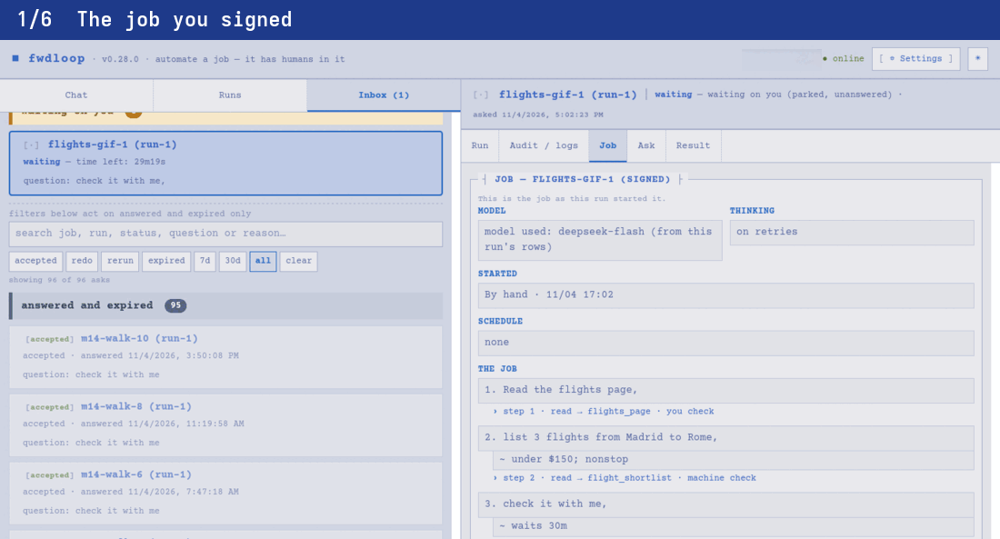

```
                    ╭──────────────────────────────────────╮
                    │  ╔═╗╦ ╦╔╦╗╦  ╔═╗╔═╗╔═╗               │
                    │  ╠╣ ║║║ ║║║  ║ ║║ ║╠═╝               │
                    │  ╚  ╚╩╝═╩╝╩═╝╚═╝╚═╝╩                 │
                    │   describe ──→ build ──→ run         │
                    │       ↑          │                   │
                    │       └── human ─┘                   │
                    ╰──╮───────────────────────────────────╯
                       ╰── workflows with people in the loop
```

<p align="center">
  
  
  
</p>

**"Automate this job — it has humans in it."** [WIP]

fwdloop builds workflows that automate jobs with a human in the loop. You describe the job
as plain steps and a few guardrails: what to gather, what to work out, where to stop and
check with a person, what to send when they say yes. An agent builds the workflow from that
description. You dry-run it, accept it once, and then it runs on its trigger, pausing where
you said, checking that every step actually happened, and staying under budgets it cannot
change.

It is built mainly for that shape of work: gather, decide, pause, hand off, continue. Not a
general agent. Not a chat bot. A workflow that a person can read, approve, rerun, and edit.

## The machine that makes machines

Like a CNC machine, fwdloop builds the thing that does the work, then lets a gauge it can't touch decide if the work is good, and stops for you where you said. Trust needs four things. Miss one and trust is zero. fwdloop has all four.

**Intent.** You write the job as plain numbered lines, and `~` rules under each say what success means. Every rule gets a check or a written reason why not. You sign before a dollar is spent.

**Guide rails, not just guardrails.** Guardrails stop the agent going off the road: a money cap per run, a monthly limit, a time limit on every Ask, and a send destination you signed that it can't move. Nothing leaves the machine without that signed destination and your accept in the same run. Guide rails keep it on the road: each new try hears what earlier tries in the run did; lessons from past runs go to the drafter and to retries; a rule it can't settle comes back as a question with buttons (Agree, Drop it, or your own words), not a guess.

**Verification.** The check sits outside the agent's loop: code decides, built on bareguard. Anything code can't check is listed as Not checked, and you judge it at the Ask. A red step goes back with the real gap to be fixed, up to four tries a step; the same miss twice stops it.

**Evidence.** Every try, its cost and its check result is recorded, and the books balance to the cent. You can read it all in the Audit tab, including exactly what each try was told. Page facts are quoted from a saved copy of the page.

The one difference from a lights-out machine: a person stands at the gate. The run parks at your Ask, spending nothing, and only after your accept does it act on the world.

## See it

A real past run: a job that reads a public flights page, lists 3 Madrid→Rome flights, asks a
human to check them, then writes the result out. Shown across the panel's Job, Run, Ask, Audit and Result tabs.



## Where it comes from

fwdloop carries forward what the bare suite learned about agentic automation: how to author
a workflow rather than hand-write it, how to gate every action, how to keep a person as the
last word, and how to make cost and outcome honest. It borrows those solved problems and
primitives directly, as a sibling of the suite, and adds the part that was missing: the
pauses, the checks, and the people.

## The bare ecosystem

Local-first, composable agent infrastructure. Same patterns throughout, each module works
standalone.

**Core** — the brain, the gate, the memory.

- **[bareagent](https://npmjs.com/package/bare-agent)** — the think→act→observe loop. *Goal in → coordinated actions out.*
- **[bareguard](https://npmjs.com/package/bareguard)** — the single gate every action passes through. *Action in → allow / deny / ask-a-human out.*
- **[litectx](https://npmjs.com/package/litectx)** — memory and context engineering (write · select · compress · isolate). *Query in → ranked context out.*

**Optional reach** — give the agent hands.

- **[barebrowse](https://npmjs.com/package/barebrowse)** — a real browser for agents.
- **[baremobile](https://npmjs.com/package/baremobile)** — Android + iOS device control.
- **[beeperbox](https://github.com/hamr0/beeperbox)** — 50+ messaging networks via one MCP server.

**Siblings** — workflows on top of the rails.

- **[bareloop](https://github.com/hamr0/bareloop)** — workflows that earn their own design, for repeated, verifiable jobs. Closed loop.
- **fwdloop** — workflows with people in them. Open loop.

## Status

Work in progress, on npm as `fwdloop` (`npm install -g fwdloop`); expect changes between versions. `fwdloop` with no arguments opens a menu to start the panel; the menu also checks for a newer fwdloop on `6 update` (online only when pressed). All jobs live in `~/.config/fwdloop/flows`, next to the settings; `--root <folder>` points a command somewhere else.

The in-run `impact` tool needs ripgrep (`rg`) on PATH; without it the tool is refused with a message, never a wrong answer.

The panel test `test/m11-am20.test.js` forces symbol fonts to prove the ◷ chip is sized by measurement, and fails on purpose when fewer than two of Symbola, FreeSans, Noto Sans Mono Condensed and Adwaita Mono are installed. On Debian/Ubuntu: `sudo apt-get install fonts-symbola fonts-freefont-ttf` (CI installs the same two).

## License

Apache-2.0. See `LICENSE` and `NOTICE`.
